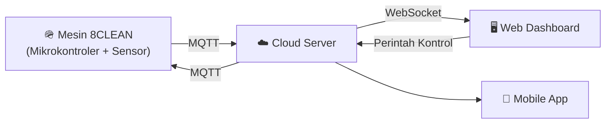

<div align="center">

  <!-- Banner Header -->
  

  <!-- Typing Animation -->
  <a href="https://git.io/typing-svg">
    
  </a>

  <!-- Social Badges -->
  <p>
    <a href="mailto:sigit.sets25@gmail.com">
      
    </a>
    <a href="https://instagram.com/setiawansgt" target="_blank">
      
    </a>
    
  </p>

</div>

---

### 📡 `$ whoami`

```cpp
// sigit_setiawan.ino
struct Engineer {
  const char* name     = "Sigit Setiawan";
  const char* role     = "IoT Engineer";
  const char* focus[3] = {"Microcontroller Development",
                          "Embedded Systems",
                          "Sensor & Device Integration"};
  const char* project  = "8CLEAN - Helmet Sterilization Vending Machine";
  const char* email    = "sigit.sets25@gmail.com";
  const char* ig       = "@setiawansgt";
};

void loop() {
  learn();
  build();
  connect();   // Things ⇄ Internet
}
```

- 🔌 **Sedang mengerjakan**: [**8CLEAN**](https://eightclean.net), mesin vending sterilisasi helm berbasis IoT.
- 🌱 **Sedang mempelajari**: Protokol komunikasi IoT, integrasi cloud, dan desain PCB.
- 💡 **Minat**: Embedded Systems, Smart Home, Industrial IoT, dan Automation.
- 📫 **Hubungi saya**: [sigit.sets25@gmail.com](mailto:sigit.sets25@gmail.com)

---

### ⚡ Keahlian Utama

<table>
  <tr>
    <td align="center" width="50%">
      <h3>🔧 Mikrokontroler Development</h3>
      <p>Merancang, memprogram, dan melakukan debugging firmware untuk berbagai board mikrokontroler, termasuk integrasi sensor, aktuator, dan modul komunikasi.</p>
    </td>
    <td align="center" width="50%">
      <h3>🌐 Konektivitas IoT</h3>
      <p>Menghubungkan perangkat ke internet untuk monitoring dan kontrol jarak jauh secara real-time melalui dashboard dan aplikasi.</p>
    </td>
  </tr>
</table>

---

### 🛠️ Hardware & Tech Stack

<div align="center">

**Microcontrollers & Boards**


**Programming**


**IoT Protocols & Platforms**


**Tools**


</div>

---

### 🚀 Proyek Unggulan

<div align="center">

## 🪖 8CLEAN — Helmet Sterilization Vending Machine

**Mesin vending disinfeksi helm pintar yang terhubung ke cloud**

<a href="https://eightclean.net" target="_blank">
  
</a>


</div>

**8CLEAN** adalah mesin vending sterilisasi helm self-service. Setiap mesin terhubung ke **platform IoT 8CLEAN**, sehingga pemilik bisa memantau dan mengendalikan mesinnya dari mana saja lewat dashboard web maupun aplikasi mobile.

<table>
  <tr>
    <td width="50%" valign="top">

**✨ Fitur Utama**
- 📡 **Real-time monitoring**: status online, heartbeat koneksi, dan 4 sensor (termasuk sensor air)
- 🎛️ **Remote control**: kirim perintah ke mesin dari dashboard
- 💰 **Laporan transaksi**: ekspor data transaksi & pendapatan per periode
- 📝 **Audit log**: transaksi & perubahan konfigurasi tercatat lengkap dengan timestamp
- 🔧 **Maintenance mudah**: perawatan mesin terpantau dari jarak jauh
- 📱 **Multi-platform**: web dashboard + aplikasi Android & iOS

</td>
    <td width="50%" valign="top">

**🧩 Varian Mesin**
- 🧼 **8CLEAN Superwash**
- 💎 **8CLEAN Ultrawash**

**⚙️ Teknologi**

`Microcontroller` `MQTT` `WebSocket` `Cloud Server` `Web Dashboard` `Mobile App`

</td>
  </tr>
</table>

**🔄 Arsitektur Sistem**



> 🔧 *Proyek lain akan segera ditambahkan.*

---

### 📊 Statistik GitHub

<div align="center">
  
  
</div>

<div align="center">
  
</div>

---

<div align="center">
  
  <sub>⚡ <i>"Connecting the physical world to the digital one, one sensor at a time."</i> — Sigit Setiawan</sub>
</div>
